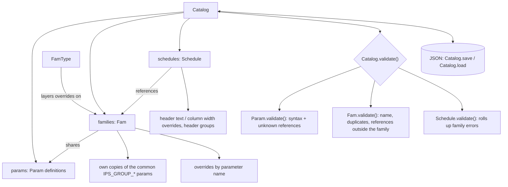

# Parameter Model Overview

## Core object relationships

## Ownership

Everything that belongs together lives in a [`Catalog`](revit_parameter_manager.py). There are
no global registries, so two catalogs never see each other's names.

- `Catalog.params` holds the parameter definitions. Names are required and unique within a catalog.
- `Catalog.families` holds families. A family's catalog parameters are the *same objects*
  as the catalog's, so editing or renaming a definition affects every family that uses it.
- Each family also gets its own copies of the common `IPS_GROUP_*` parameters (same GUIDs),
  so changing one family's copy never leaks into another family.
- `Catalog.schedules` holds schedules, which reference families.
- Objects built without a catalog (`Param('Width', 'Length')`) are standalone: they validate
  against their own contents only.

Build through the catalog: `catalog.add_param(...)`, `catalog.add_family(name, param_names)`,
`catalog.add_schedule(name, family_names)`, and the matching `remove_*` methods.

## Schedules: headers and column widths

- Each `Param` has a default `header_text` (its name unless set) and a default
  `grid_column_width` in inches.
- `Schedule.header_text_overrides` and `Schedule.grid_column_width_overrides` hold per-schedule
  values keyed by parameter name; `Schedule.override_param(...)` sets or clears them.
- `Schedule.header_groups` stores group captions, member parameter names (which must be
  contiguous in the schedule) and header-row bounds.
- A schedule lists each parameter once, even when several of its families share it.

Header groups store stable parameter names rather than Revit column indices. A Revit adapter
resolves those names to the visible schedule columns when it calls `ViewSchedule.GroupHeaders`,
since Revit's left/right indices exclude hidden fields. The effective grid width is the
schedule override when present, otherwise the parameter default; the Revit macro generator
converts inches to feet for `ScheduleField.GridColumnWidth`.

## Formulas

[formula.py](formula.py) tokenizes formulas. Known parameter names are matched first, longest
first and only on identifier boundaries, so `Rough Width` is one reference and `Width` never
matches inside `GlassWidth`. Leftover identifiers that are not formula functions (`IF`, `MAX`,
`PI`, ...) are unknown references.

`check_syntax` reports unbalanced parentheses, unterminated strings, unexpected characters, and
missing values or operators.

## Validation

- `Param.validate()` flags syntax problems and references to names the catalog doesn't know.
- `Fam.validate()` flags a family with no name, no parameters of its own, duplicate
  parameters, or formulas that reference catalog parameters the family doesn't include.
- `Schedule.validate()` rolls up its families' errors.
- `Catalog.validate()` runs all three and returns `(kind, name, message)` for each error.

## Renames and GUIDs

`Catalog.rename_param` (or `Param.rename`, `Fam.rename_param`, `Schedule.rename_param`) rewrites
every formula that references the parameter, and moves overrides, schedule header/width
overrides and header-group members keyed by its old name.

A rename assigns a **new GUID by default**. Pass `keep_guid=True` to keep the current one.
`guid_change_warning()` gives the text to show first: Revit labels that use the parameter must
be remapped to the new GUID if it changes.

## Persistence

`Catalog.save(path, extra=None)` writes versioned JSON (`version: 2`); `Catalog.load(path)`
returns `(catalog, extra)`. Families store catalog parameters by name and family-local
parameters in full; schedules in a catalog store family names. A standalone schedule's
`to_dict()` embeds its families instead.

## GUI

[ddm_gui.py](ddm_gui.py) keeps its data in DataFrames (the tables are its source of truth) and
saves them in its own CSV/checkpoint files. On every validation it builds a fresh `Catalog` from
the tables and copies each object's status and message back into the rows.

The GUI stores each parameter's GUID in a `guid` column. A blank GUID defaults to the name-based
GUID from `parameter_guid()` in [revit_shared_parameter_export.py](revit_shared_parameter_export.py),
and both Revit exporters use the stored GUID. Renaming a parameter in the GUI asks whether to
assign a new GUID, then rewrites the old name in family links, schedule entries, header groups
and formulas, mirroring `Catalog.rename_param`.

Making the model the GUI's source of truth (and switching its saves to `Catalog.save`) is still
open; see the development plan.
