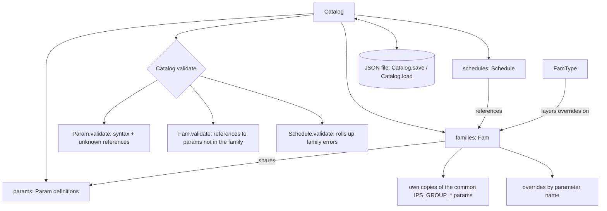

# Parameter Model Overview

## Core object relationships

## Ownership

Everything lives in a [`Catalog`](revit_parameter_manager.py). There are no global
registries, so two catalogs never see each other's names.

- `Catalog.params` holds the parameter definitions. Names are unique within a catalog.
- `Catalog.families` holds families. A family's catalog parameters are the *same objects*
  as the catalog's, so editing or renaming a definition affects every family that uses it.
- Each family also gets its own copies of the common `IPS_GROUP_*` parameters (same GUIDs),
  so changing one family's copy never leaks into another family.
- `Catalog.schedules` holds schedules, which reference families.
- Objects built without a catalog (`Param('Width', 'Length')`) are standalone: they
  validate against their own names only.

Build through the catalog: `catalog.add_param(...)`, `catalog.add_family(name, param_names)`,
`catalog.add_schedule(name, family_names)`, and the matching `remove_*` methods.

## Formulas

[formula.py](formula.py) tokenizes formulas. Known parameter names are matched first,
longest first and only on identifier boundaries, so `Rough Width` is one reference and
`Width` never matches inside `GlassWidth`. Leftover identifiers that are not formula
functions (`IF`, `MAX`, `PI`, ...) are unknown references.

`check_syntax` reports unbalanced parentheses, unterminated strings, unexpected characters,
and missing values or operators.

## Validation

- `Param.validate()` flags syntax problems and references to names the catalog doesn't know.
- `Fam.validate()` flags a family with no name or no parameters of its own, and formulas that
  reference catalog parameters the family doesn't include.
- `Schedule.validate()` rolls up its families' errors.
- `Catalog.validate()` runs all three and returns `(kind, name, message)` for each error.

## Renames and GUIDs

`Catalog.rename_param` (or `Param.rename`, `Fam.rename_param`, `Schedule.rename_param`) rewrites
every formula that references the parameter and moves any overrides keyed by its old name.

A rename assigns a **new GUID by default**. Pass `keep_guid=True` to keep the current one.
`guid_change_warning()` gives the text to show first: Revit labels that use the parameter must
be remapped to the new GUID if it changes. The GUI asks before every rename.

## Persistence

`Catalog.save(path, extra=None)` writes versioned JSON (`version: 2`); `Catalog.load(path)`
returns `(catalog, extra)`. Families store catalog parameters by name and family-local
parameters in full. The GUI stores its Schedules-tab rows under `extra`.

## GUI

[parameter_catalog_gui.py](parameter_catalog_gui.py) holds one `Catalog`. Its Parameters and
Families tables (and the family–parameter links) are views rebuilt from the catalog after every
change, and edits go through model methods. Status, validation message and GUID are read-only.

The Schedules tab is still presentation data: its override entries are not yet connected to
the model.
