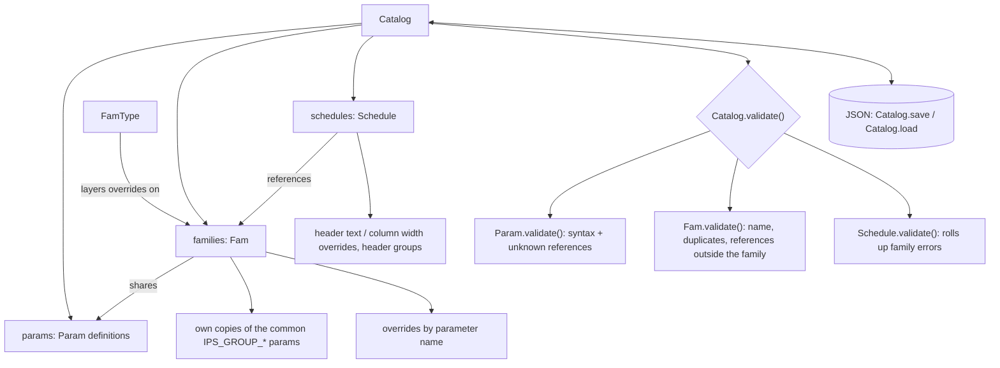

# Parameter Model Overview

## Core object relationships

## Ownership

Everything that belongs together lives in a [`Catalog`](revit_parameter_manager.py). There are
no global registries, so two catalogs never see each other's names.

- `Catalog.params` holds the parameter definitions. Names are required and unique within a catalog.
- `Catalog.families` holds families. A family's catalog parameters are the *same objects*
  as the catalog's, so editing or renaming a definition affects every family that uses it.
- Each family also gets its own copies of the common `IPS_GROUP_*` parameters (same GUIDs),
  so changing one family's copy never leaks into another family.
- `Catalog.schedules` holds schedules, which reference families.
- `Catalog.codes` holds one code (abbreviation) per client and per country:
  `{'client': {name: code}, 'country': {name: code}}`. A family names its client and country;
  `fam.client_code` and `fam.country_code` look the code up, so changing a client's code changes it
  for every family with that client. `catalog.names(kind)`, `catalog.code(kind, name)` and
  `catalog.set_code(kind, name, code)` read and write them; codes are unique within each kind.
- Objects built without a catalog (`Param('Width', 'Length')`) are standalone: they validate
  against their own contents only.

Build through the catalog: `catalog.add_param(...)`, `catalog.add_family(name, param_names)`,
`catalog.add_schedule(name, family_names)`, and the matching `remove_*` methods.

## Schedules: headers and column widths

- Each `Param` has a default `header_text` (its name unless set) and a default
  `grid_column_width` in inches.
- `Schedule.header_text_overrides` and `Schedule.grid_column_width_overrides` hold per-schedule
  values keyed by parameter name; `Schedule.override_param(...)` sets or clears them.
- `Schedule.header_groups` stores group captions, member parameter names (which must be
  contiguous in the schedule) and header-row bounds.
- A schedule lists each parameter once, even when several of its families share it.
- `Schedule.field_names` picks the schedule's columns, in order. `None` (the default) shows
  every parameter of every family.

## Overriding values

A parameter's value can be overridden in two places:

- **For a family everywhere:** `Fam.overrides`, set with `Fam.override_param(...)`.
- **For a family in one schedule only:** `Schedule.family_overrides`, set with
  `Schedule.override_family_param(...)`.

The schedule override wins over the family override, which wins over the parameter's default.
A family can override the value, formula and group under; a schedule only the value
(`Schedule.FAMILY_OVERRIDABLE_ATTRIBUTES`), since formula and group under belong to the family
in Revit. Family formula overrides are validated like parameter formulas and follow renames.
Passing `None` for an attribute clears that override.

`Catalog.apply_override(location, param_name, ...)` sets or clears an override at a location,
`(family_name, None)` for the family everywhere or `(family_name, schedule_name)` for one
schedule, and `Catalog.resolved_value(location, param_name)` gives the effective value there.

Header groups store stable parameter names rather than Revit column indices. A Revit adapter
resolves those names to the visible schedule columns when it calls `ViewSchedule.GroupHeaders`,
since Revit's left/right indices exclude hidden fields. The effective grid width is the
schedule override when present, otherwise the parameter default; the Revit macro generator
converts inches to feet for `ScheduleField.GridColumnWidth`.

## Formulas

[formula.py](formula.py) tokenizes formulas. Known parameter names are matched first, longest
first and only on identifier boundaries, so `Rough Width` is one reference and `Width` never
matches inside `GlassWidth`. Leftover identifiers that are not formula functions (`IF`, `MAX`,
`PI`, ...) are unknown references.

`check_syntax` reports unbalanced parentheses, unterminated strings, unexpected characters, and
missing values or operators.

## Validation

- `Param.validate()` flags syntax problems and references to names the catalog doesn't know.
- `Fam.validate()` flags a family with no name, no parameters of its own, duplicate
  parameters, or formulas that reference catalog parameters the family doesn't include.
- `Schedule.validate()` rolls up its families' errors.
- `Catalog.validate()` runs all three and returns `(kind, name, message)` for each error.

## Renames and GUIDs

`Catalog.rename_param` (or `Param.rename`, `Fam.rename_param`, `Schedule.rename_param`) rewrites
every formula that references the parameter, and moves overrides, schedule header/width
overrides and header-group members keyed by its old name.

A rename assigns a **new GUID by default**. Pass `keep_guid=True` to keep the current one.
`guid_change_warning()` gives the text to show first: Revit labels that use the parameter must
be remapped to the new GUID if it changes.

## Persistence

`Catalog.save(path, extra=None)` writes versioned JSON (`version: 3`; version 2 files still load); `Catalog.load(path)`
returns `(catalog, extra)`. Families store catalog parameters by name and family-local
parameters in full; schedules in a catalog store family names. A standalone schedule's
`to_dict()` embeds its families instead.
Client and country codes are saved as `clients` and `countries` maps (files without them load
with no codes). In the CSV they appear on each family row as `client_code` and `country_code`.

## GUI

[ddm_gui.py](ddm_gui.py) holds a `Catalog`, which is its source of truth. The Parameters, Families
and Schedules tables are views rebuilt from it after every change, and edits go through model
methods, so an invalid edit is rejected with an error rather than stored.

[ddm_tables.py](ddm_tables.py) converts between the catalog and flat tables (parameters, families,
links, schedule entries, header groups). The readable CSV, the older pickle checkpoints and the
Revit exporters all use those tables. Loading tables fixes or skips anything the catalog can't
hold (unknown links, invalid widths, duplicate names, ...) and lists each problem in Messages.

Saves write `Catalog.save` JSON (`*.ddm.json`), plus a readable CSV and the Revit exports
alongside. CSV and older `.ddm.pkl` files still load.

Renaming a parameter asks whether to assign a new GUID, then `Catalog.rename_param` updates
every reference. A blank GUID in loaded data defaults to the name-based GUID from
`parameter_guid()` in [revit_shared_parameter_export.py](revit_shared_parameter_export.py), and
both Revit exporters use the stored GUID.

Values are overridden from a schedule's detail window (that family in that schedule) or a
family's detail window (the family everywhere). The override dialog lists the connected places
to apply the same value to (from a schedule, the other families in it; from a family, the
schedules it is in) and offers to make it the parameter's default value.
